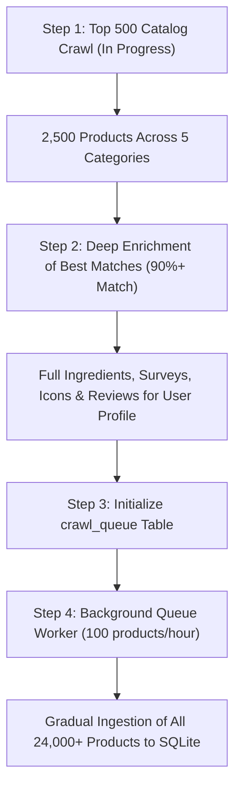

> Historical record. This document describes an earlier design, experiment or release; counts, paths and provider assumptions may be outdated. Use the [current development guide](../DEVELOPMENT.md) and [source layout](../SOURCE_LAYOUT.md) for supported commands and ownership.

# 🏗️ Skintellect Continuous Crawling & Queue Architecture
## Enterprise-Grade Architecture for Full Catalog (24,000+ Products) Extraction

---

### 1. Executive Summary

Skintellect hosts over **24,000 products** and hundreds of thousands of individual user reviews across 5 core skincare categories (*Moisturizers, Sunscreens, Serums, Toners, Cleansers*) and secondary categories (*Eye Care, Treatments, Face Masks*).

Attempting to scrape 24,000 products synchronously in a single run triggers Cloudflare anti-bot rate limits (HTTP 429) or IP blacklisting. This document defines the **Continuous Distributed Task Queue & Adaptive Pacing Engine** to systematically, politely, and reliably ingest the entire database into local SQLite storage over time without detection or rate limiting.

---

### 2. The Core Engineering Challenges

| Challenge | Impact if Unhandled | Mitigation in Proposed Architecture |
| :--- | :--- | :--- |
| **Cloudflare Rate Limiting (HTTP 429)** | Sudden IP blocks, dropped connections | Adaptive exponential backoff, jittered human delay (1.2s–2.8s), and cooldown pauses. |
| **Session & Cookie Drift** | Loss of personalized match score access | Canary probe health-check that flags when session tokens or `cf_clearance` need renewal. |
| **Interrupted Runs / Crashes** | Duplicate requests or lost progress | Persistent SQLite Task Queue with atomic state transitions (`pending` → `running` → `completed`). |
| **Network Latency Variability** | Timeout exceptions | Dynamic timeout scaling based on a moving average of recent response latencies. |
| **Massive Scale (24,000+ items)** | Excessive memory consumption | Streaming Turbo-Frame ingestion with batched DB commits; zero in-memory accumulation. |

---

### 3. Architecture Blueprint

```text
┌────────────────────────────────────────────────────────────────────────┐
│                        SKINSORT CLOUD (Rails / Turbo)                  │
└────────────────────────────────────▲───────────────────────────────────┘
                                     │ (HTTP / Cloudflare Bypass Headers)
                                     ▼
┌────────────────────────────────────────────────────────────────────────┐
│                   ADAPTIVE HUMAN-MIMIC RATE LIMITER                    │
│  • Pacing Jitter (1.2s - 2.8s)        • Natural Reading Pauses (5s-8s) │
│  • Exponential Backoff (15s, 30s, 60s)• Canary Health Check            │
└────────────────────────────────────▲───────────────────────────────────┘
                                     │
┌────────────────────────────────────┴───────────────────────────────────┐
│                    CONTINUOUS BACKGROUND WORKER DAEMON                 │
│  • Polls `crawl_queue` for next batch (50-100 items/hour)              │
│  • Off-peak scheduling (runs during quiet network hours)               │
│  • Atomic state commits & exception isolation                          │
└────────────────────────────────────▲───────────────────────────────────┘
                                     │
┌────────────────────────────────────┴───────────────────────────────────┐
│                   PERSISTENT SQLITE DATABASE ENGINE                    │
│                                                                        │
│   ┌─────────────────────┐    ┌─────────────────────┐                   │
│   │     crawl_queue     │    │      products       │                   │
│   │ (State & Attempts)  │    │  (Catalog & Specs)  │                   │
│   └──────────┬──────────┘    └──────────┬──────────┘                   │
│              │                          │                              │
│   ┌──────────┴──────────┐    ┌──────────┴──────────┐                   │
│   │     ingredients     │    │       reviews       │                   │
│   │ (529+ Unique Nodes) │    │ (Skin Types/Ver.)   │                   │
│   └─────────────────────┘    └─────────────────────┘                   │
└────────────────────────────────────────────────────────────────────────┘
```

---

### 4. Database Queue Schema (`crawl_queue`)

To guarantee **100% resumability**, all scrape targets are converted into lightweight tasks in a dedicated SQLite table:

```sql
CREATE TABLE IF NOT EXISTS crawl_queue (
    id INTEGER PRIMARY KEY AUTOINCREMENT,
    task_type TEXT NOT NULL,         -- 'catalog_page', 'product_detail', 'product_reviews'
    category_slug TEXT,              -- 'moisturizers', 'sunscreens', etc.
    target_id INTEGER,               -- product_id or page_number
    target_url TEXT NOT NULL,        -- absolute URL to scrape
    priority INTEGER DEFAULT 1,      -- 10 = Top Match (95%+), 5 = Standard, 1 = Low
    status TEXT DEFAULT 'pending',   -- 'pending', 'running', 'completed', 'failed'
    attempts INTEGER DEFAULT 0,
    max_attempts INTEGER DEFAULT 4,
    last_error TEXT,
    last_attempt_at TIMESTAMP,
    completed_at TIMESTAMP,
    created_at TIMESTAMP DEFAULT CURRENT_TIMESTAMP
);

CREATE INDEX IF NOT EXISTS idx_queue_status_prio ON crawl_queue(status, priority DESC);
CREATE INDEX IF NOT EXISTS idx_queue_url ON crawl_queue(target_url);
```

---

### 5. Adaptive Pacing & Human Behavior Simulation

To stay entirely invisible to Cloudflare WAF:

1. **Jittered Micro-Delays**:
   - Instead of static timers (`sleep(1)`), use random gaussian/uniform distributions:
     $$\Delta t = \text{random.uniform}(1.3, 2.7) \text{ seconds}$$
2. **Reading Interval Emulation**:
   - Every 6–8 requests, simulate a human reading user reviews:
     $$\Delta t_{\text{pause}} = \text{random.uniform}(4.5, 7.5) \text{ seconds}$$
3. **Three-Tier Exponential Backoff**:
   - If an HTTP 429 occurs:
     - **Attempt 1**: Cool down 15–20 seconds.
     - **Attempt 2**: Cool down 45–60 seconds.
     - **Attempt 3**: Cool down 180 seconds and notify monitor.
4. **Throughput Target**:
   - Steady rate: **60 to 100 products per hour**.
   - Daily volume: **~1,800 to 2,400 products per day**.
   - Full 24,000+ catalog timeline: **~10 to 12 days of polite background crawling**.

---

### 6. Paced Background Worker Implementation

A standalone daemon script `queue_worker.py` that can be run overnight or via Windows Task Scheduler:

```python
def run_queue_worker(batch_size=50, sleep_between_batches=60):
    while True:
        tasks = fetch_pending_tasks(limit=batch_size)
        if not tasks:
            print("[*] Queue empty. Sleeping 5 minutes...")
            time.sleep(300)
            continue
            
        for task in tasks:
            mark_task_running(task['id'])
            success = process_task(task)
            if success:
                mark_task_completed(task['id'])
            else:
                mark_task_failed(task['id'])
            time.sleep(random.uniform(1.4, 2.8))
            
        time.sleep(sleep_between_batches)
```

---

### 7. Immediate vs. Long-Term Roadmap


