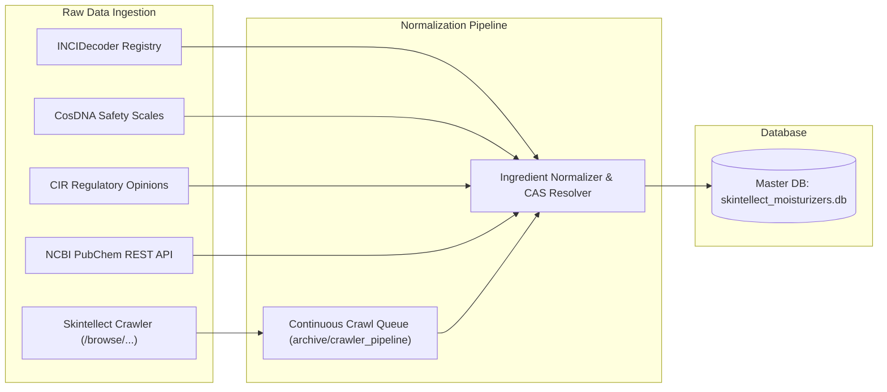

> Historical record. This document describes an earlier design, experiment or release; counts, paths and provider assumptions may be outdated. Use the [current development guide](../DEVELOPMENT.md) and [source layout](../SOURCE_LAYOUT.md) for supported commands and ownership.

# Multi-Domain & Multi-Source Expansion Roadmap

This document outlines the strategic roadmap for scaling **Formulation Studio** from facial skincare into a universal personal care intelligence engine encompassing **Hair & Scalp**, **Bath & Body**, and **Makeup & Complexion**.

---

## 1. Domain Coverage Specifications

### A. 💇 Hair & Scalp Care (Trichology & Strands)
* **Target Anatomical Areas**:
  * Scalp & Hair Follicles (Seborrheic dermatitis, follicular congestion, hair fall)
  * Mid-Lengths & Strands (Cuticle damage, porosity, tensile elasticity, protein-moisture balance)
  * Ends (Split ends, lipid stripping)
* **Categories**:
  * Shampoos (Clarifying, Hydrating, Sulfate-Free, Dandruff/Anti-Fungal)
  * Conditioners & Cowashes
  * Scalp Serums (Peptides, Rosemary, Minoxidil vehicles, Salicylic acid)
  * Hair Masks & Bond Builders (Bis-aminopropyl diglycol dimaleate, hydrolyzed keratin)
  * Leave-In Conditioners & Hair Oils (Argan, Jojoba, Squalane)
* **Formulation Guardrails**:
  * **Sulfate Audit**: Flag sodium lauryl sulfate (SLS) vs gentle glucoside/isethionate surfactants.
  * **Silicone / CGM Approved**: Detect non-water-soluble silicones (Dimethicone, Amodimethicone) vs Curly Girl Method approved formulas.
  * **Scalp Malassezia Safety**: Dandruff is driven by *Malassezia restricta / globosa*; hair products must be audited for fungal-feeding lipids.
  * **Protein Balance**: Balance hydrolyzed proteins (collagen, wheat, silk) against heavy emollients.

---

### B. 🧼 Bath & Body Care (Body Dermatology)
* **Target Anatomical Areas**:
  * Full Body Surface (Stratum corneum xerosis, barrier lipids)
  * Back & Chest (Bacne zone: high density of sebaceous glands prone to micro-comedones)
  * Arms & Legs (Extensor surfaces prone to Keratosis Pilaris / "strawberry skin")
  * Hands & Feet (Thick stratum spinosum requiring high-potency urea/glycerin)
* **Categories**:
  * Body Washes & Cleansing Oils
  * Body Lotions & Barrier Creams (Ceramide body creams)
  * Chemical Body Scrubs (AHA/BHA body lotions)
  * Targeted Hand & Foot Salves
* **Formulation Guardrails**:
  * **Bacne Comedogenicity**: Screen body lotions and conditioners that run down the back for high-pore-clogging esters.
  * **Keratolytic Potency**: Verify therapeutic concentration of Urea (5–10%), Lactic Acid (5–12%), and Salicylic Acid (2%).

---

### C. 💄 Makeup & Complexion (Cosmetic Dermatology)
* **Target Anatomical Areas**:
  * Complexion / Base (Full face, T-zone, pores)
  * Lips (Vermilion border, lack of sebaceous glands)
  * Periorbital Eye Area (Thin sensitive skin, tear ducts)
* **Categories**:
  * Foundations & Skin Tints (Liquid, Powder, Cushion)
  * Concealers & Primers
  * Setting Powders & Sprays
  * Lip Balms, Lip Oils & Tints
* **Formulation Guardrails**:
  * **Non-Acnegenic Base**: Screen heavy synthetic esters (Isopropyl Myristate, Isostearyl Isostearate, Ethylhexyl Palmitate).
  * **Barrier-Infused Complexion**: Credit formulas featuring skincare-level barrier lipids (Squalane, Niacinamide, Hyaluronic acid).
  * **Eye Safety**: Exclude migrating volatile fragrance, high-irritancy preservatives, and synthetic dyes near tear ducts.

---

## 2. Multi-Source Ingestion Architecture

---

## 3. Database Schema Extensions for Multi-Domain

The schema has been prepared with multi-domain columns:

1. **`products` Table**:
   * `domain TEXT DEFAULT 'skin'` — `'skin'`, `'hair'`, `'body'`, `'makeup'`.
   * `target_area TEXT DEFAULT 'face'` — `'face'`, `'scalp'`, `'strands'`, `'body'`, `'lips'`, etc.
   * `sulfate_free INTEGER DEFAULT 0` — Key metric for hair care and body washes.
   * `silicone_free INTEGER DEFAULT 0` — Key metric for CGM and lightweight facial skincare.

2. **`ingredients` Table**:
   * `domains_json TEXT` — `["skin", "hair", "body"]`.
   * `sources_json TEXT` — `["skinsort", "incidecoder", "pubchem"]`.
   * `target_areas_json TEXT` — `["face", "scalp", "strands"]`.
